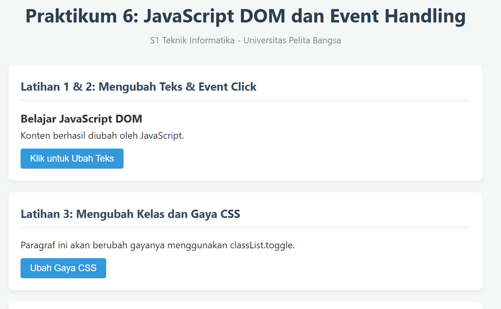
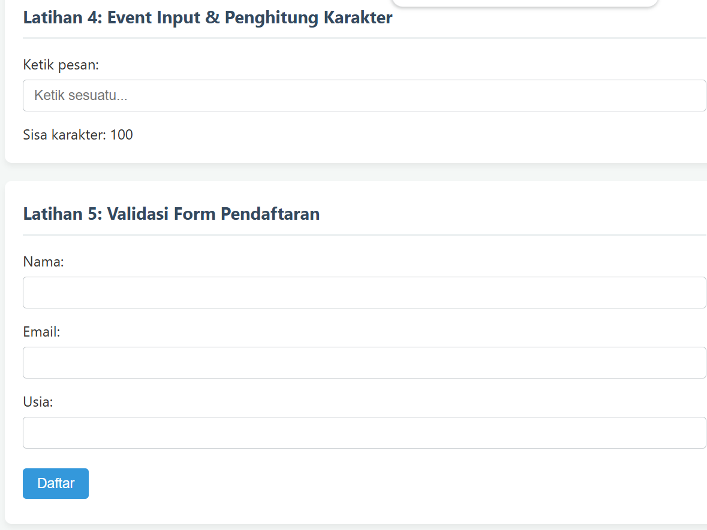
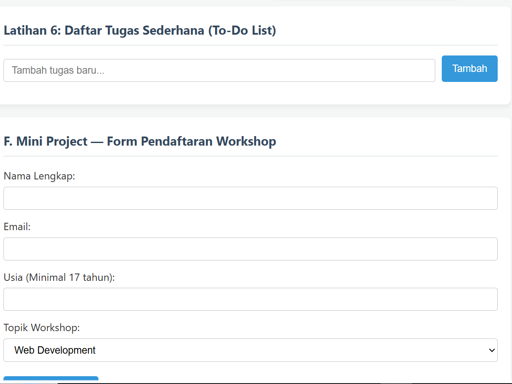
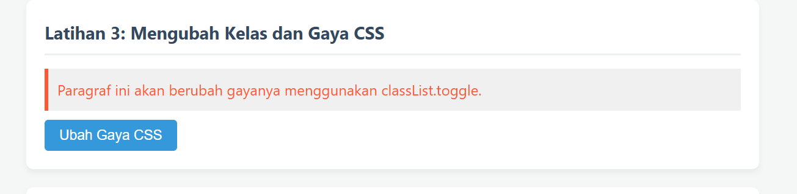
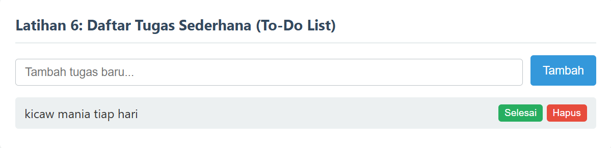

# Praktikum 6: JavaScript DOM dan Event Handling
**Mata Kuliah:** Pemrograman Web  
**Pertemuan:** 7  
**Program Studi:** S1 Teknik Informatika  
**Institusi:** Universitas Pelita Bangsa  

---

## 📋 1. Penjelasan Projek Modul
Projek ini dikembangkan sebagai bagian dari Modul Praktikum 6 dengan fokus pada pengenalan dan penguasaan **Document Object Model (DOM)** serta **Event Handling** dalam JavaScript. Melalui projek ini, mahasiswa mempelajari cara mengakses elemen HTML, memanipulasi konten, mengubah atribut dan gaya CSS secara dinamis, menangani berbagai jenis event interaktif, melakukan validasi form sisi klien (*client-side validation*), hingga membangun aplikasi web interaktif sederhana seperti To-Do List dan Form Pendaftaran Workshop.

---

## 🛠️ 2. Langkah Pembuatan Projek
Berikut adalah langkah-langkah praktis dalam membuat dan menjalankan projek ini:

1. **Membuat Struktur Folder:**
   * Buat folder kerja baru di komputer/laptop Anda, misalnya diberi nama `lab6_dom_event`.
2. **Membuat Berkas Kode Utama:**
   * Buat file **`index.html`** untuk menyusun struktur elemen HTML halaman web.
   * Buat file **`style.css`** untuk mendesain tampilan dan tata letak (*styling*).
   * Buat file **`script.js`** untuk menuliskan logika JavaScript DOM dan penanganan event.
3. **Menghubungkan Berkas:**
   * Hubungkan file CSS di dalam tag `<head>` menggunakan `<link rel="stylesheet" href="style.css">`.
   * Hubungkan file JavaScript di bagian bawah tag `<body>` menggunakan ``.
4. **Menjalankan Projek:**
   * Buka file `index.html` langsung di browser favorit Anda atau gunakan ekstensi *Live Server* di Visual Studio Code agar perubahan dapat disinkronkan secara otomatis.
   * Gunakan *Developer Tools* (tekan `F12` atau klik kanan > *Inspect*) pada browser untuk memantau *Console* jika diperlukan.

---

## ❓ 3. Pertanyaan Evaluasi & Jawaban
Berikut adalah daftar pertanyaan evaluasi dari modul beserta pembahasannya:

1. **Apa yang dimaksud dengan DOM dan apa manfaatnya?**
   * *Jawaban:* DOM (*Document Object Model*) adalah representasi terstruktur dari dokumen HTML dalam bentuk objek yang dapat diakses dan dimanipulasi oleh bahasa pemrograman (seperti JavaScript). Manfaatnya adalah memungkinkan pengembang untuk mengubah teks, struktur HTML, gaya CSS, serta merespons interaksi pengguna secara dinamis tanpa perlu memuat ulang halaman.

2. **Apa perbedaan getElementById, querySelector, dan querySelectorAll?**
   * *Jawaban:* 
     * `getElementById`: Mengambil satu elemen secara spesifik berdasarkan atribut `id`-nya.
     * `querySelector`: Mengambil elemen *pertama* yang cocok dengan pemilih CSS tertentu (misalnya `#id`, `.class`, atau tag).
     * `querySelectorAll`: Mengambil *semua* elemen yang cocok dengan pemilih CSS tertentu dalam bentuk *NodeList* (koleksi elemen).

3. **Apa fungsi addEventListener() dan sebutkan contoh event?**
   * *Jawaban:* `addEventListener()` digunakan untuk mendaftarkan fungsi penanganan (*event handler*) pada suatu elemen agar mendengarkan event tertentu yang terjadi. Contoh event meliputi: `click`, `input`, `change`, `submit`, `keydown`, dan `mouseover`.

4. **Mengapa preventDefault() digunakan pada event submit form?**
   * *Jawaban:* `event.preventDefault()` digunakan untuk mencegah perilaku bawaan browser saat form dikirimkan (yakni melakukan *refresh* atau memuat ulang halaman secara otomatis), sehingga proses validasi JavaScript dapat dijalankan terlebih dahulu secara asinkron.

5. **Apa perbedaan textContent dan innerHTML, dari segi penggunaan dan keamanan?**
   * *Jawaban:*
     * `textContent`: Hanya memproses teks murni (*plain text*). Lebih aman digunakan karena tidak mengeksekusi tag HTML di dalamnya.
     * `innerHTML`: Dapat membaca dan memproses tag HTML di dalam string. Perlu diwaspadai karena rentan terhadap kerentanan keamanan seperti *Cross-Site Scripting (XSS)* jika menerima input mentah dari pengguna.

6. **Bagaimana classList.toggle() membantu mengubah tampilan elemen?**
   * *Jawaban:* Metode `classList.toggle()` berfungsi untuk memeriksa keberadaan suatu kelas CSS pada elemen; jika kelas tersebut belum ada, maka kelas akan ditambahkan, dan jika sudah ada, maka kelas akan dihapus secara otomatis layaknya tombol saklar (*switch*).

7. **Sebutkan minimal tiga skenario pengujian validasi form.**
   * *Jawaban:* 
     1. Pengujian ketika semua kolom dibiarkan kosong (validasi field kosong).
     2. Pengujian format email yang tidak valid (misal: tanpa tanda `@` atau domain).
     3. Pengujian batasan nilai numerik atau usia (misal: usia di bawah syarat minimal 17 tahun).

---

## 📸 4. Bukti Screenshot Projek
*Berikut adalah lampiran bukti tangkapan layar (*screenshot*) saat menjalankan latihan dan mini project di browser:*

* **Tampilan Antarmuka Keseluruhan halaman awal:**
   
   
   

* **Tampilan Antarmuka Keseluruhan & Latihan 1-3:**
   
   
  
* **Tampilan Interaksi Latihan 4 & 5 (Penghitung Karakter & Validasi Form):**
  
  

* **Tampilan To-Do List & Mini Project Form Workshop:**
  
  